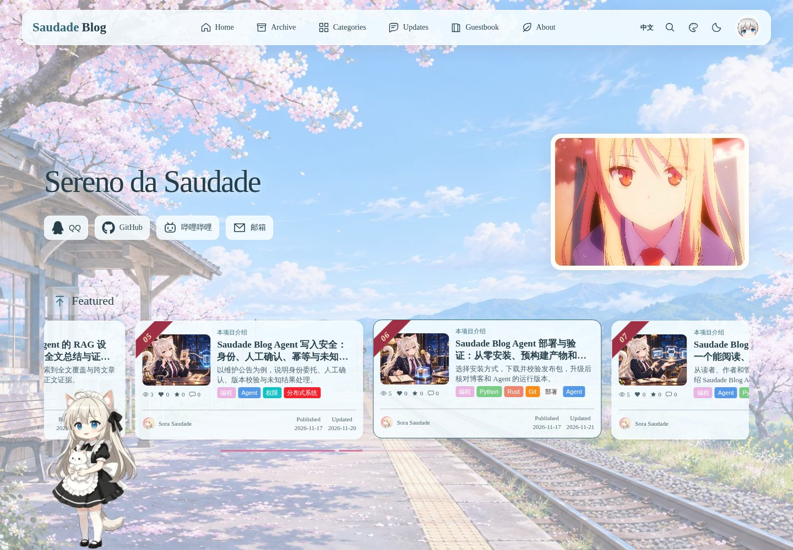
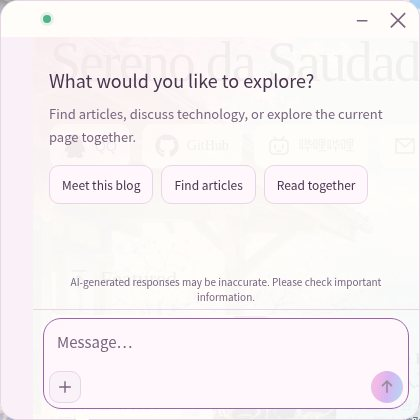
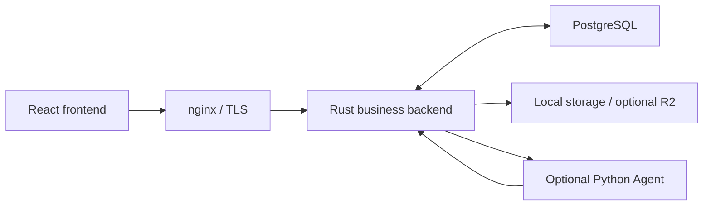

<div align="center">

# Saudade Blog

**English** · [简体中文](README.zh-CN.md)

[](https://github.com/BigLeopardCat/Saudade-Blog/actions/workflows/deploy.yml)
[](https://github.com/BigLeopardCat/Saudade-Blog/releases/latest)
[](Cargo.toml)
[](LICENSE)

[](https://saudade.site/)
[](docs/en/README.md)
[](docs/en/engineering-cases.md)

</div>

A self-hosted blog and content management application with article publishing, categories and tags, a media gallery, reader interactions, and optional agent-assisted workflows.

The backend uses **Rust / Axum / SeaORM / PostgreSQL**; the frontend uses **React / TypeScript / Vite**. The blog owns business data, authentication, permissions, and transactions. The separate [Saudade Blog Agent](https://github.com/BigLeopardCat/saudade-blog-agent) supplies model execution and the Lingyue chat widget.

Public pages and chat controls support English and Chinese, with a persistent language switch and synchronization across tabs. Articles and user content retain their original language; administration has not been fully translated. The live site reflects its deployed version, and administration requires an authorized account.

## Interface preview

### Blog homepage



Browse articles, categories and tags, search the site, and open Lingyue from the mascot toolbar in the lower left.

### Lingyue chat



Use suggested prompts to explore the blog, find articles or read together, or enter your own question. Authorized users can also collaborate on writing and prepare content management operations; writes requiring approval show a review step first.

Actual screenshots of the public interface at [saudade.site](https://saudade.site/). Interface controls support English and Chinese; article content retains its original language. See the [tutorials (中文)](docs/wiki/Home.md) for more workflows.

## Capabilities

| Area | Behavior |
| --- | --- |
| Publishing | Article editing, drafts, cover selection, categories/tags, and version-aware save/publish flows |
| Reading and interaction | Article browsing/search, comments, announcements, reader accounts, and personal activity |
| Media | Local persistent gallery storage, optional R2, and separately approved image-generation workflows |
| Optional Agent | Source-backed article questions, writing assistance, reviewed operations, and supported scheduled tasks |
| Operations | Fixed-source builds, prebuilt packages, isolated service accounts, backups, and restore/recovery checks |

The core blog runs independently. Model providers, Agent, moderation, R2, and device integration are optional; configure only the capabilities you need.



## Install or develop

For deployment, start with the [English setup guide](docs/en/getting-started.md). When a matching prebuilt release is available, verify its manifest and checksums before following the [prebuilt installation guide (中文)](deploy/prebuilt.md). Native packages have platform/ABI requirements; container installation requires Docker Engine and Docker Compose 2.30+.

For local development, use Rust 1.92+, the Node version in [.node-version](.node-version), and a dedicated PostgreSQL 16 instance:

```sh
git clone https://github.com/BigLeopardCat/Saudade-Blog.git
cd Saudade-Blog
cp .env.example .env
```

Set up the development database and apply the schema/migrations using the [setup guide](docs/en/getting-started.md). After configuring development-only credentials, start the backend with `cargo run`. In another terminal:

```sh
cd frontend
npm ci
npm run fetch:widget
npm run vendor:live2d
npm run dev
```

Widget source lives in the Agent repository. This host pins the source commit and subtree hashes in `frontend/widget.lock.json`; fetch the widget before preparing the renderer runtime.

## Inspect the engineering

[Architecture](docs/en/architecture.md) explains business/state ownership and the Agent boundary. [Engineering cases](docs/en/engineering-cases.md) cover version-aware editor changes and independently versioned host/runtime/widget delivery. Agent-side [context, retrieval, and write-recovery cases](https://github.com/BigLeopardCat/saudade-blog-agent/blob/main/docs/en/engineering-cases.md) are maintained with their implementation.

[Public CI](https://github.com/BigLeopardCat/Saudade-Blog/actions) checks Rust, disposable PostgreSQL, frontend types/components, browser interactions, and container installation/recovery. Synthetic interfaces and isolated installation checks are identified separately from production behavior and real-model evaluation. A passing build or merged PR does not prove deployment.

## Documentation and contribution

- **Guides:** [English](docs/en/README.md) · [中文](docs/README.md) · [Wiki tutorials (中文)](https://github.com/BigLeopardCat/Saudade-Blog/wiki)
- **Engineering:** [Cases](docs/en/engineering-cases.md) · [User guide (中文)](docs/user-guide.md)
- **Contribute:** [Contribution guide](CONTRIBUTING.md) · [Roadmap](ROADMAP.md) · [Security](SECURITY.md)

English core guides and Chinese operational/protocol references are linked by topic. Use documentation from your source revision or release. Both repositories use `main` as their primary branch. English contributions are welcome under the shared commit and verification rules.

## License

Blog code is distributed under [GPL-2.0-or-later](LICENSE); see [third-party notices](THIRD-PARTY.md). Agent widget code is MIT licensed, while character/art assets have separate terms in the [Agent asset license](https://github.com/BigLeopardCat/saudade-blog-agent/blob/main/frontend/ASSETS-LICENSE.md).
