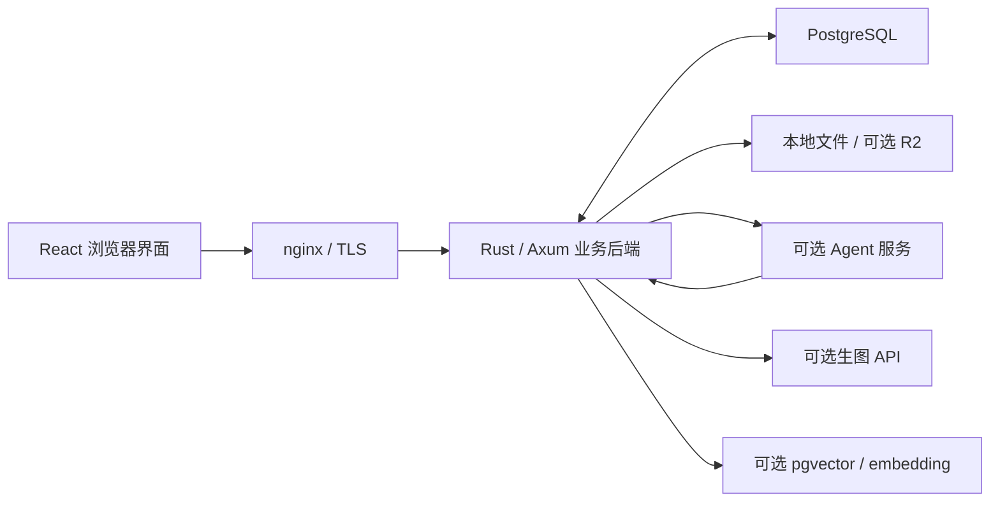

# Saudade Blog

可独立部署的个人博客与内容管理应用，覆盖写作发布、阅读检索、图库和站内互动；可选接入 Agent 协作与 AI 生图。

后端使用 **Rust / Axum / SeaORM / PostgreSQL**，前端使用 **React / TypeScript / Vite**。业务数据、权限和事务由博客管理，模型执行由独立的 [Saudade Blog Agent](https://github.com/BigLeopardCat/saudade-blog-agent) 提供。

[在线博客](https://saudade.site/) · [使用指南](docs/user-guide.md) · [部署](deploy/docker/README.md) · [架构](docs/architecture.md) · [版本发布](https://github.com/BigLeopardCat/Saudade-Blog/releases)

在线站点展示实际部署；后台管理和协作编辑需要管理员身份。

## 从写作到管理

| 场景 | 当前能力 |
| --- | --- |
| 写作与发布 | Markdown、公式和 Mermaid，草稿保存、标题与摘要、分类标签、封面布局及发布设置 |
| 阅读与发现 | 文章流自动加载、置顶封面、聚合检索、分类标签、时间轴、收藏和评论 |
| 图库整理 | 默认本地存储、可选 R2；文件夹、详情预览、描述与收藏，批量移动/复制及跨存储转移 |
| 站内互动 | 河灯留言、公告、个人通知、站内信和未读汇总；管理员审核、账号与内容管理 |
| Agent 协作 | 看板娘对话、文章取证问答、编辑器差异审阅、人工确认写入和来源会话结果回报 |
| AI 生图 | 后台界面审阅提示词、参考图及生成参数，批准后生成；查看结果再确认入库，需要封面时另行选择 |

界面操作与合成数据截图见[使用指南](docs/user-guide.md)。

## 架构与业务边界



| 工程问题 | 当前处理方式 |
| --- | --- |
| 编辑与发布冲突 | 区分原文、草稿和编辑器工作副本；保存与发布校验版本，避免旧自动保存覆盖新内容。[协作编辑](docs/article-collaboration.md) |
| 内容加载与分页 | 首页使用游标和卡片摘要投影；后台按查询条件分页，数量与当前页条目分别表达。[数据流](docs/architecture.md#数据流与一致性) |
| 图片与资产生命周期 | 图片身份、存储位置和分类元数据分别管理；本地与 R2 使用统一图库入口，预览与原始资产权限分开。[使用指南](docs/user-guide.md#图库与-ai-生图) |
| Agent 写入与账号隔离 | Rust 复核当前身份、目标及业务版本；Agent 负责提议与确认，聊天文本和客户端回报不提供授权。[安全边界](docs/security-boundary.md) |
| 付费任务与故障恢复 | 生图请求与结果入库分别审阅；后台任务有并发和停机边界，未知结果不自动重发付费请求。[运行架构](docs/architecture.md#可选能力) |

博客保存业务事实和聊天原文；Agent 保存模型执行 checkpoint 与任务预算。组件职责、源码目录和跨仓契约见[架构文档](docs/architecture.md)。

## 可选能力怎么接入

核心博客的写作、阅读、管理、普通检索和本地图库不需要运行 Agent，也不需要模型或 R2 密钥。

| 可选能力 | 依赖与未启用时的边界 |
| --- | --- |
| 对话与协作编辑 | 独立 Agent、模型端点和 Agent 状态数据库；未启用时不提供这些交互，普通博客照常运行 |
| 管理员 AI 生图 | Rust 直接使用配置的生图 API，不要求运行 Agent；Agent 可调用同一受控业务入口 |
| AI 辅助审核 | 可配置独立 `AI_REVIEW_URL`，或接 Agent 的审核端点；人工审核不依赖模型 |
| 文章向量图谱 | 暂停提供可视化入口与图谱 API；保留构建工具源码，普通搜索与 Agent RAG 不受影响 |
| R2 对象存储 | 按需配置；未配置时使用本地图库存储 |

图谱的数据来源、构建及降级见[可选构建工具](tools/article-graph/README.md)。IoT 为独立的[可选演示集成](iot/README.md)，不作为博客安装前置条件。

## 安装与发布验证

当前公开版本为 [v0.2.0](https://github.com/BigLeopardCat/Saudade-Blog/releases/tag/v0.2.0)。首次安装可在 Linux 构建机使用 Docker Engine 与 Docker Compose 2.30+：

```sh
git clone --branch v0.2.0 https://github.com/BigLeopardCat/Saudade-Blog.git
cd Saudade-Blog
bash deploy/install.sh --site-url http://localhost:8080
```

默认安装核心博客，绑定回环地址；公开域名、TLS、管理员初始化和可选 Agent 需按[容器指南](deploy/docker/README.md)配置。当前提供固定源码构建；镜像转移和离线启动方式也见该指南，尚未提供公共预构建镜像。现有 systemd 实例使用[固定版本发布流程](docs/deployment-and-ops.md)。

[公开 PR 检查](https://github.com/BigLeopardCat/Saudade-Blog/actions) 验证 Rust、临时 PostgreSQL、前端类型与组件、Playwright 浏览器，以及容器安装、备份恢复与失败回退。仅博客安装和启用 Agent 的组合分别验证，不依赖维护者服务器或私有密钥。浏览器测试使用真实组件和合成接口数据；隔离验收不等于真实流量表现或所有线上操作已经完成。

配套 Agent 的模型任务通过率、缓存与时延见 [Agent 发布证据](https://github.com/BigLeopardCat/saudade-blog-agent/releases)；这些指标不代替博客自身的功能与部署验收。

## 开发起步

需要 Rust 1.92+、Node 24.22.1（见 `.node-version`）和 PostgreSQL 16。

```sh
git clone https://github.com/BigLeopardCat/Saudade-Blog.git
cd Saudade-Blog
cp .env.example .env
```

创建开发数据库与应用角色，按[开发指南](CONTRIBUTING.md)应用 PostgreSQL 基线及编号迁移。填写 `DATABASE_URL`、随机 `JWT_SECRET` 和本站地址，再启动：

```sh
cargo run
```

另开终端运行前端：

```sh
cd frontend
npm ci
npm run fetch:widget
npm run vendor:live2d
npm run dev
```

看板娘源码在 Agent 仓库；本仓通过 `frontend/widget.lock.json` 固定提交与子树哈希。组件下载先于 Live2D vendor 准备，构建缺失资源时应失败。

## 文档

[使用指南](docs/user-guide.md) · [文档索引](docs/README.md) · [架构](docs/architecture.md) · [开发](CONTRIBUTING.md) · [部署运维](docs/deployment-and-ops.md) · [安全边界](docs/security-boundary.md)

短使用步骤与版本相关说明随源码维护；更长的场景教程可放 Wiki 并链接这些文档。截图使用合成数据，避免包含真实账号、私信与密钥。

## 贡献与许可

提交采用 `type(scope): 中文说明`，完整检查见 [CONTRIBUTING.md](CONTRIBUTING.md)。后续方向见 [ROADMAP.md](ROADMAP.md)，用户可见变化见 [CHANGELOG.md](CHANGELOG.md)，安全问题见 [SECURITY.md](SECURITY.md)。

博客代码按 [GPL-2.0](LICENSE) 分发，来源与第三方声明见 [THIRD-PARTY.md](THIRD-PARTY.md)。Agent 聊天组件代码使用 MIT，角色及美术资源另有许可，见 [Agent 资源许可](https://github.com/BigLeopardCat/saudade-blog-agent/blob/main/frontend/ASSETS-LICENSE.md)。
