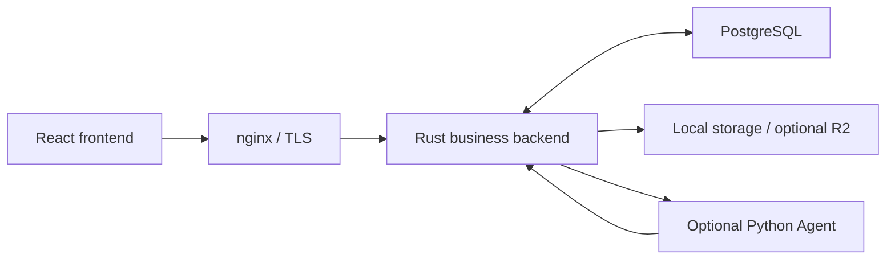

# Saudade Blog

English · [简体中文](README.zh-CN.md)

A self-hosted blog and content management application with article publishing, categories and tags, a media gallery, reader interactions, and optional agent-assisted workflows.

The backend uses **Rust / Axum / SeaORM / PostgreSQL**; the frontend uses **React / TypeScript / Vite**. The blog owns business data, authentication, permissions, and transactions. The separate [Saudade Blog Agent](https://github.com/BigLeopardCat/saudade-blog-agent) supplies model execution and the Lingyue chat widget.

[Live site](https://saudade.site/) · [Technical guide](docs/en/README.md) · [Engineering cases](docs/en/engineering-cases.md) · [Releases](https://github.com/BigLeopardCat/Saudade-Blog/releases)

The current UI, tutorials, and most articles are in Chinese. English documentation is available below; this does not imply that the product already has an English UI. The live site reflects its deployed version, and administration requires an authorized account.

## Capabilities

| Area | Behavior |
| --- | --- |
| Publishing | Article editing, drafts, cover selection, categories/tags, and version-aware save/publish flows |
| Reading and interaction | Article browsing/search, comments, announcements, reader accounts, and personal activity |
| Media | Local persistent gallery storage, optional R2, and separately approved image-generation workflows |
| Optional Agent | Source-backed article questions, writing assistance, reviewed operations, and supported scheduled tasks |
| Operations | Fixed-source builds, prebuilt packages, isolated service accounts, backups, and restore/recovery checks |

The core blog runs independently. Model providers, Agent, moderation, R2, and device integration are optional; configure only the capabilities you need.



## Install or develop

For deployment, start with the [English setup guide](docs/en/getting-started.md). When a matching prebuilt release is available, verify its manifest and checksums before following the [prebuilt installation guide (中文)](deploy/prebuilt.md). Native packages have platform/ABI requirements; container installation requires Docker Engine and Docker Compose 2.30+.

For local development, use Rust 1.92+, the Node version in [.node-version](.node-version), and a dedicated PostgreSQL 16 instance:

```sh
git clone https://github.com/BigLeopardCat/Saudade-Blog.git
cd Saudade-Blog
cp .env.example .env
```

Set up the development database and apply the schema/migrations using the [setup guide](docs/en/getting-started.md). After configuring development-only credentials, start the backend with `cargo run`. In another terminal:

```sh
cd frontend
npm ci
npm run fetch:widget
npm run vendor:live2d
npm run dev
```

Widget source lives in the Agent repository. This host pins the source commit and subtree hashes in `frontend/widget.lock.json`; fetch the widget before preparing the renderer runtime.

## Inspect the engineering

[Architecture](docs/en/architecture.md) explains business/state ownership and the Agent boundary. [Engineering cases](docs/en/engineering-cases.md) cover version-aware editor changes and independently versioned host/runtime/widget delivery. Agent-side [context, retrieval, and write-recovery cases](https://github.com/BigLeopardCat/saudade-blog-agent/blob/main/docs/en/engineering-cases.md) are maintained with their implementation.

[Public CI](https://github.com/BigLeopardCat/Saudade-Blog/actions) checks Rust, disposable PostgreSQL, frontend types/components, browser interactions, and container installation/recovery. Synthetic interfaces and isolated installation checks are identified separately from production behavior and real-model evaluation. A passing build or merged PR does not prove deployment.

## Documentation and contribution

[English guide](docs/en/README.md) · [中文文档](docs/README.md) · [User guide (中文)](docs/user-guide.md) · [Wiki (中文)](https://github.com/BigLeopardCat/Saudade-Blog/wiki) · [Contributing](CONTRIBUTING.md) · [Roadmap](ROADMAP.md) · [Security](SECURITY.md)

English core guides and Chinese operational/protocol references are linked by topic. Use documentation from your source revision or release. Both repositories use `main` as their primary branch. English contributions are welcome under the shared commit and verification rules.

## License

Blog code is distributed under [GPL-2.0](LICENSE); see [third-party notices](THIRD-PARTY.md). Agent widget code is MIT licensed, while character/art assets have separate terms in the [Agent asset license](https://github.com/BigLeopardCat/saudade-blog-agent/blob/main/frontend/ASSETS-LICENSE.md).
