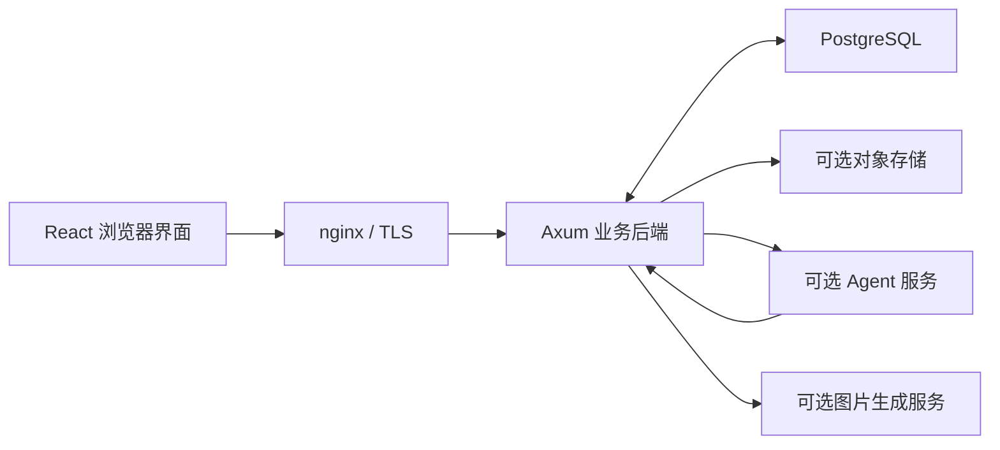

# 架构

## 组件

Rust 后端拥有账号、文章、图库、通知、信箱和业务事务；Agent 通过受控 API 使用这些能力。业务字段计算、版本条件、分页与权限位于后端。浏览器负责工作副本、交互和实际页面操作的回报。

## 目录

| 路径 | 职责 |
| --- | --- |
| `src/main.rs` | 服务启动、数据库与路由装配 |
| `src/routes/` | 业务 HTTP 入口与事务 |
| `src/entity/` | 数据模型 |
| `src/lifecycle.rs` | HTTP 与已接受后台任务的优雅停机 |
| `frontend/src/` | 阅读、后台、共享组件与客户端状态 |
| `scripts/migration/pg/` | PostgreSQL 基线与编号迁移 |
| `scripts/`、`deploy/` | CI、部署、健康检查与服务模板 |
| `tests/`、`frontend/tests/` | Rust、数据库与前端回归 |
| `iot/` | 可选设备演示 |

## 数据流与一致性

- 文章原文、草稿和编辑器工作副本分别管理。保存和发布使用版本条件，不能让旧自动保存覆盖已发布的新内容。
- Agent 提议不等于执行；人工确认后后端再次验证目标、权限及版本。浏览器回报仅证明本地动作，不证明数据库保存或发布。
- 聊天原文由博客存储，运行 checkpoint 与任务预算由 Agent 管理。用户删除触发双方清理；宿主不再生成并回写运行摘要。
- 公开语料通过带修订号的分页快照导出；消费者验证完整性后发布索引。异常和半页结果不能冒充空语料。
- 图库身份由图片记录与对象键决定，文件夹和描述是业务元数据。签名预览只授权指定用途和短期读取，不能作为登录凭据。

## 可选能力

Agent、AI 审核、向量服务、图片生成及 IoT 均是外部可选服务。核心博客部署不依赖它们启动；相关入口应显示未配置或不可用。外部失败不应拖垮普通页面或持有无界后台任务。

聚合检索是文本入口；向量图谱是可选的文章浏览方式，不是聊天记忆。建图读取公开文章、使用明确的 embedding 配置并发布产物，不为每次前端切换重复重建。RAG 输入和检索算法由 Agent 仓维护，宿主仅提供[语料契约](rag-corpus-api.md)。

AI 生图经两次人工批准：冻结请求后调用计费服务，返回结果待审，批准入库后才形成图库资产。运行并发受限，停机等待已经接受的请求和结果持久化，不自动重发结果未知的付费请求。

## 测试与发布

PR 检查不需要维护者服务器、密钥或 Agent 实例，数据库测试使用 CI 的临时 PostgreSQL。浏览器测试加载真实组件并拦截接口；未预期网络和页面错误使其失败。

主线发布固定源码快照，通过检查后构建并部署。Agent 独立发布，前端组件版本由 lock 固定；跨仓接口改动需分别核对部署顺序。详细操作见[运维](deployment-and-ops.md)。
