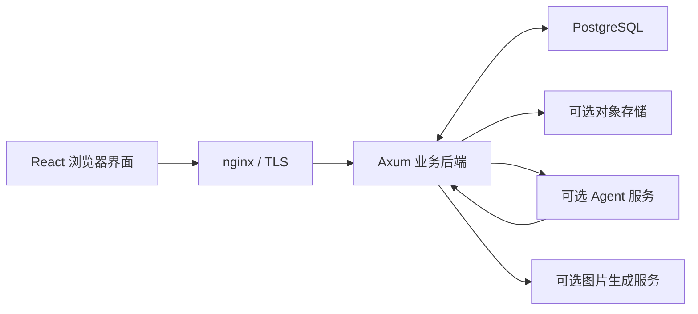
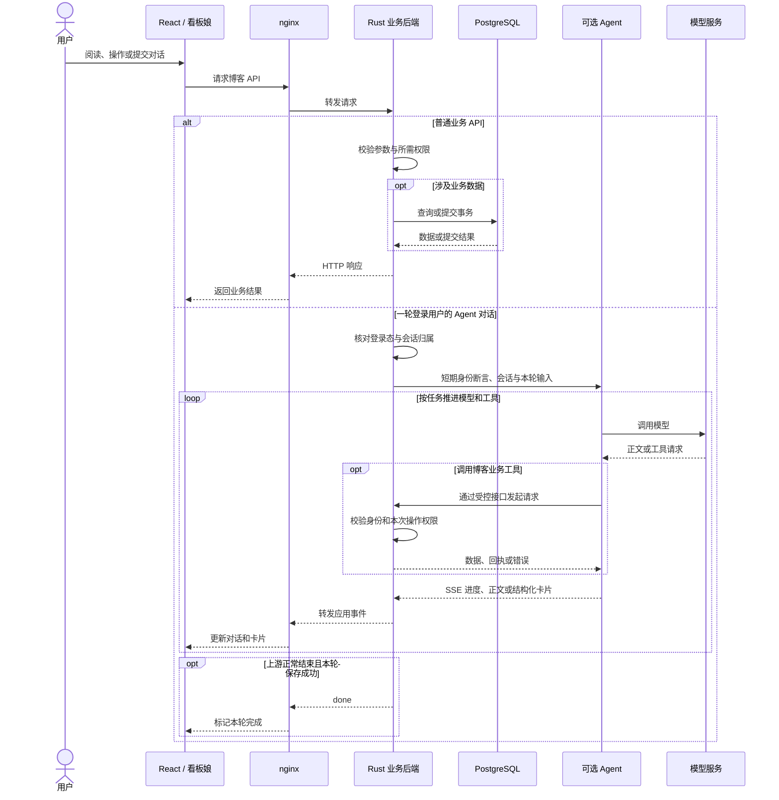

# 博客系统架构

## 系统范围

博客提供阅读、写作、内容管理和站内互动。核心站点由浏览器、nginx、Rust 后端与 PostgreSQL 组成，图库默认使用本地持久存储。Agent 作为可选集成，使用宿主的业务接口和身份边界。

## 组件

Rust 后端拥有账号、文章、图库、通知、信箱和业务事务；Agent 通过受控 API 使用这些能力。业务字段计算、版本条件、分页与权限位于后端。浏览器负责工作副本、交互和实际页面操作的回报。

## 端到端请求时序

登录用户的对话采用流式交付，涉及业务写入时由对应契约检查人工确认和执行结果。[宿主聊天持久化](chat-persistence.md)说明保存顺序，[Agent 架构](https://github.com/BigLeopardCat/saudade-blog-agent/blob/main/docs/agent-architecture.md)说明模型循环、执行状态与暂停接续。

## 数据流与一致性

| 对象 | 权威来源与边界 |
| --- | --- |
| 账号权限、文章、图库和互动数据 | 由博客后端校验并写入业务库。版本条件与事务保护并发变更。[安全边界](security-boundary.md) |
| 编辑器工作副本与草稿 | 浏览器维护工作副本，宿主区分草稿与发布版本。[协作编辑](article-collaboration.md) |
| 业务变更与浏览器动作 | 数据库或业务回执证明事务结果，浏览器回报证明页面动作。[安全边界](security-boundary.md) |
| 聊天与执行状态 | 博客保存对话原文和展示回执。Agent 持有运行 checkpoint、预算及执行账。[聊天持久化](chat-persistence.md) |
| 公开语料与索引 | 博客发布带修订的语料快照。Agent 核验完整语料后更新检索索引，两者独立推进。[语料接口](rag-corpus-api.md) |

## 可选能力

Agent、AI 审核、图片生成和 IoT 按配置接入。核心博客可以独立启动。外部服务故障影响对应功能，普通阅读和业务界面继续运行。图库可选 R2。

聚合搜索提供文本入口。发布构建关闭文章向量图谱界面和在线查询，保留离线建图工具。Agent RAG 消费公开语料接口。[离线图谱工具](../tools/article-graph/README.md)

AI 生图先批准参数再调用供应商，结果审阅后另行批准入库。宿主限制并发并等待已接受任务持久化，未知结果通过原任务核对。

源码及回归入口见[代码导读](code-reading.md)，组件与版本组合见[兼容与升级](compatibility-and-upgrades.md)。
