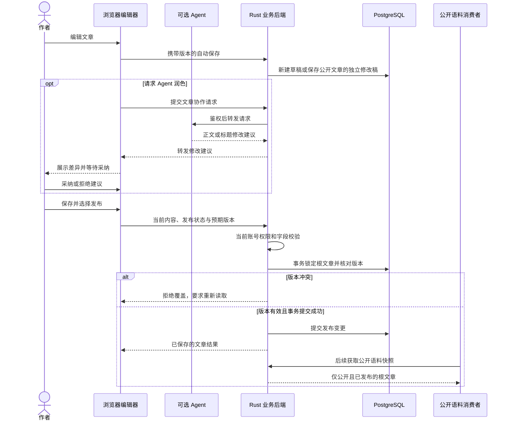

# 文章协作编辑

管理员打开文章编辑器后，可让 Agent 读取当前工作副本，建议修改标题和正文，准备摘要概述，以及打开发布流程。普通聊天不默认携带整篇正文。

## 审阅与保存

- 标题和正文使用真实 `diff` 结果展示，删除红色、新增绿色。建议本身不覆盖原文，逐段或整批采纳后通过编辑器事务写入，可撤销。
- 摘要由 `prepare_article_summary` 产生聊天确认卡，批准后才覆盖概述字段；不展示正文式差异。
- `prepare_article_publication` 在现有编辑页保存当前草稿并打开发布审阅。用户无需退出编辑器；最终发布仍由发布流程检查并确认。
- 本地采纳、服务器保存和正式发布是不同状态。Agent 不能把浏览器已接收命令说成文章已发布。

## 并发与恢复

工具读取返回编辑器标识、本地修订和有界片段；修改引用刚读取的版本。继续输入、切换文章或刷新后，旧提案不能覆盖新内容，需要重新读取。

`GET /api/protected/draft/editor/{id}` 返回原文、草稿与版本；保存/发布携带版本条件。过期自动保存、旧发布与并发覆盖返回冲突，不能静默成功。正文修改使用唯一匹配的 `old_text` / `new_text`，不做模糊替换。

客户端动作通过 Agent 的 LangGraph interrupt 等待有界回报；工具标识用于断点重放，独立读取使用新标识。回报不授予业务权限，也不是数据库事务凭据。

## 保存、审阅与发布

采纳编辑器建议、自动保存草稿、发布文章、更新 RAG 索引是四个不同事实。
Agent 的客户端回报不能代替发布回执。语料消费者仍须完整抓取、核验版本并成功发布索引，
不能在文章发布后立即声称检索已经更新；详见[语料接口](rag-corpus-api.md)。

## 回归

Rust/PostgreSQL 验证版本条件和保存/发布冲突。真实 ByteMD 浏览器测试验证标题/正文差异、采纳、原生撤销、摘要确认后应用、继续输入、账号切换与发布对话框。Agent 使用真实框架恢复工具调用，不能仅用桩最终回答替代链路验证。
