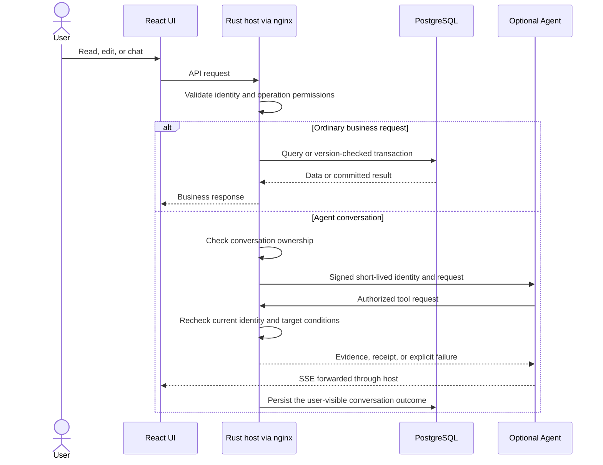

# Host architecture and consistency

[Guide](README.md) · [中文：系统架构](../architecture.md)

## Responsibilities

The core application is a React browser UI behind nginx, an Axum/SeaORM Rust backend, and PostgreSQL. The host owns accounts, article/draft versions, categories/tags, media metadata, interactions, notifications, and the business rules for their mutation. Gallery files use persistent local storage by default, with optional R2.

The Python Agent is an optional service. It receives host-verified identity and bounded page observations, selects tools, and explains returned evidence. It does not replace the host's authorization, optimistic version checks, or transactions. The browser owns unsaved editor state and must review/adopt proposed edits before ordinary save/publish operations.

## A request through the system

This is a logical overview; progress and answer events stream during execution. The host's terminal chat event has its own persistence boundary, described in [chat persistence](../chat-persistence.md). Neither model prose nor receipt of a browser command proves that business data was committed.

## Consistency and trust

| Boundary | Rule |
| --- | --- |
| Login and permissions | Validate the session and current account state in the host; chat text is untrusted data |
| Tool delegation | Use host-issued limited delegation; do not share login signing authority with the Agent |
| Editor state | Keep browser working copy, stored draft, and published version distinct |
| Concurrent edits | Submit the expected version and reject stale updates instead of overwriting a newer revision |
| Business writes | Keep applicable version checks, mutations, and business receipts in the host transaction |
| Public RAG corpus | Export revision-bound public content; the Agent separately validates complete snapshots and evidence |

The frontend widget, Agent runtime, and host evolve independently. [Compatibility](../compatibility-and-upgrades.md) explains their separate locks and release ordering. Optional provider outages affect their features rather than granting a bypass around business validation.

## Code navigation

| Path | Responsibility |
| --- | --- |
| [src/](../../src/) | Axum endpoints, authentication, business services, and entities |
| [src/routes/chat/](../../src/routes/chat/) | Agent proxy, chat lifecycle, and persistence integration |
| [src/routes/notes.rs](../../src/routes/notes.rs) | Article route integration |
| [frontend/src/](../../frontend/src/) | Pages, editor state, and UI integration |
| [scripts/migration/pg/](../../scripts/migration/pg/) | PostgreSQL baseline and numbered migrations |
| [deploy/](../../deploy/) | Installation, container templates, account isolation, and release tooling |

For finer paths, follow [code reading](../code-reading.md), [editor collaboration](../article-collaboration.md), [security](../security-boundary.md), and the [Agent architecture](https://github.com/BigLeopardCat/saudade-blog-agent/blob/main/docs/en/architecture.md).
