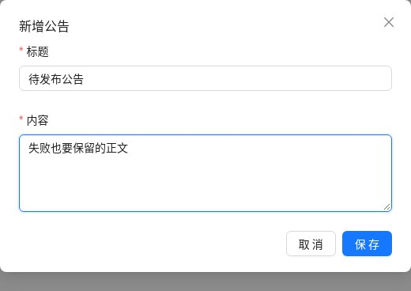

# 全站公告、个人通知和站内信

先区分受众：**公告是全站内容，通知是发给指定账号的业务消息，站内信是个人信箱内容。**
删除自己的通知副本不等于删除全站公告。

## 发布公告

1. 管理员打开后台「公告」，点击「新增公告」。
2. 填写标题与完整正文，核对链接、时间、措辞和受众；长正文向下滚动读完。
3. 点击保存，等待明确成功，核对公告列表和前台展示。
4. 需要首页突出展示时，在列表设置置顶，再检查首页置顶区。

图：新增公告的标题、正文和保存按钮。示例数据仅用于说明。

界面截图中的测试正文不代表推荐公告内容。通过 Agent 发布时先准备并审阅确认卡，
卡片还会展示关联个人通知的影响；不要把“准备成功”说成“已经发布”。

## 编辑、删除和置顶

编辑从目标行进入，核对准确公告和完整正文后保存。置顶只影响展示位置，不能代替发布。
删除前检查正文与通知影响，批量删除先勾选明确对象；删除不是关闭弹窗或“我知道了”。

公告会形成关联个人通知。全站公告变更和个人通知按业务规则同步，
删除公告也会影响关联副本；具体以删除提示和实际回执为准。

## 发送个人通知

管理员在「用户管理」找到准确账号，点击「发通知」，填写标题和正文，核对接收人后提交。
此流程不会把消息发布到全站。群体或多账号操作通过 Agent 准备时，逐项核对确认卡的接收范围。

普通用户在个人中心查看通知、未读和站内信。先打开全文再决定已读或删除；
Agent 的读取行为不一定自动标为已读，修改已读状态属于独立操作。

## 结果未知怎么办

保存失败且草稿仍在时，先阅读失败原因。请求超时、断流或无明确结果时，先查询列表与原操作回执，
不要换一个新请求连续发布。Agent 的即时公告可按稳定操作编号核对历史回执。
历史成功说明当时提交过，公告后来可能已被修改或删除。

**完成标志：**目标公告/通知可重新读取、受众正确、未读或置顶状态与操作一致。
详见[通知与信箱](https://github.com/BigLeopardCat/Saudade-Blog/blob/cn_sora_blog/docs/mailbox-api.md)。
