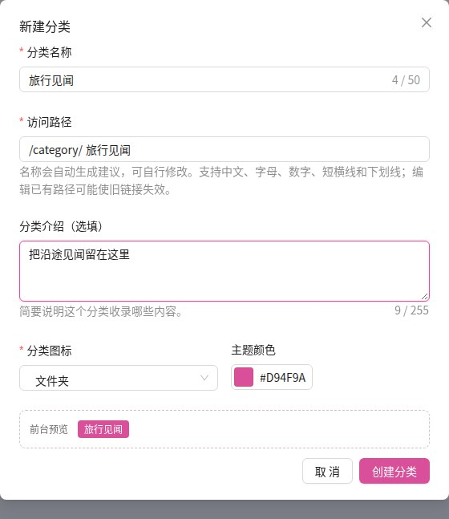
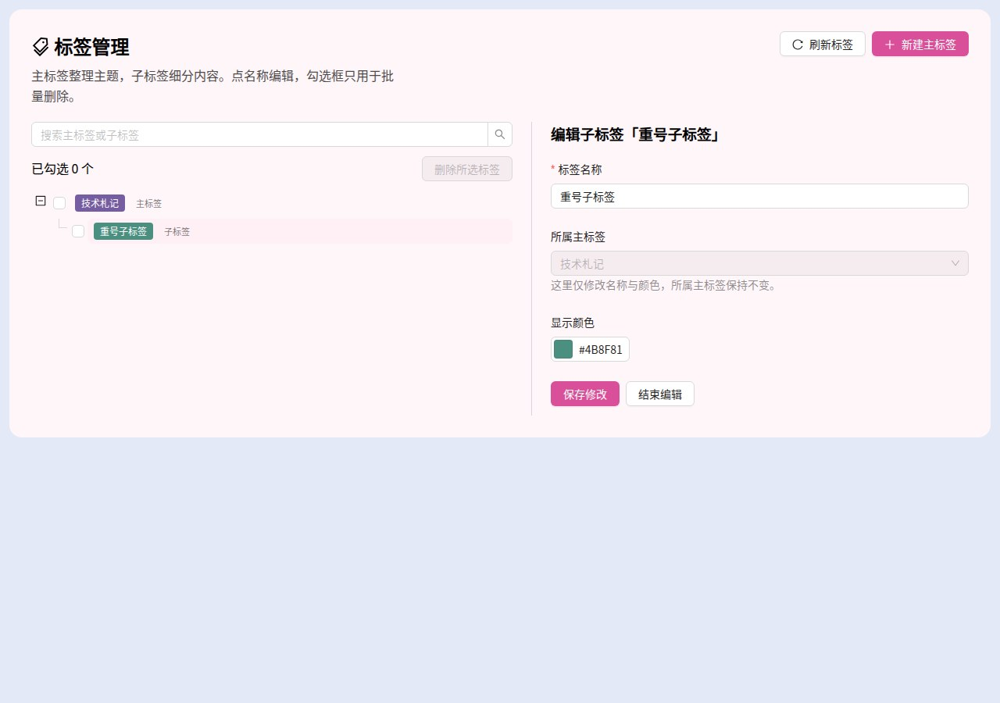

# 分类和标签：先建字典，再给文章选择

**需要：**管理员账号。入口在后台「笔记 → 全部分类 / 全部标签」。
分类适合文章的主要栏目；标签描述可交叉检索的主题。创建字典项不会自动修改已有文章。

## 建立第一个分类

1. 打开「全部分类」，点击「新建分类」。
2. 分类名称填“技术札记”，访问路径使用稳定、简短的名称，例如 `tech-notes`。
3. 填写介绍；需要时选择颜色与图标。分类名称是展示文字，访问路径用于链接，不要把完整网址填进去。
4. 点击「创建分类」，看到新条目后重新打开编辑，核对保存的字段。
5. 打开一篇文章，在发布设置中选择该分类，保存或发布后再从前台分类入口核对。

图：新建分类，展示名称、路径、介绍和创建按钮。示例数据仅用于说明。

修改已有分类时按具体条目进入编辑。名称变化不等于必须改访问路径；已有链接在使用时，先评估路径变更。
列表为空与读取失败不同。失败时保留表单，先处理提示，不反复创建同名条目。

## 建立主标签和子标签

1. 打开「全部标签」，创建一个主标签，例如“开发”。
2. 选中这个主标签，点击「在此主标签下新建子标签」，输入“Rust”。
3. 创建后核对子标签显示在正确的父标签下。
4. 编辑一个已有标签时核对界面显示“主标签”还是“子标签”，不要仅凭数字编号判断层级。
5. 回到文章编辑/发布设置选择需要的标签，保存后检查前台标签和检索结果。

图：父子标签树与当前编辑层级。示例数据仅用于说明。

同一数字编号可以来自不同层级。重命名字典与调整某篇文章的标签集合是两种操作；
若只想给文章加标签，不需要新建一个同名标签。

## 删除之前

先查询关联文章与提示中的影响范围，必要时给文章换到其他分类或标签，再删除目标字典项。
不要假定删除分类等同于删除文章，也不要把删除文章等同于清空字典。
通过 Agent 修改时，使用准确名称或编号，并核对确认卡上的层级、父标签和目标文章。

**完成标志：**字典列表能重读到保存结果，目标文章保存后显示正确分类/标签。
当前接口范围见[后台目录](https://github.com/BigLeopardCat/Saudade-Blog/blob/cn_sora_blog/docs/admin-catalog-api.md)。
