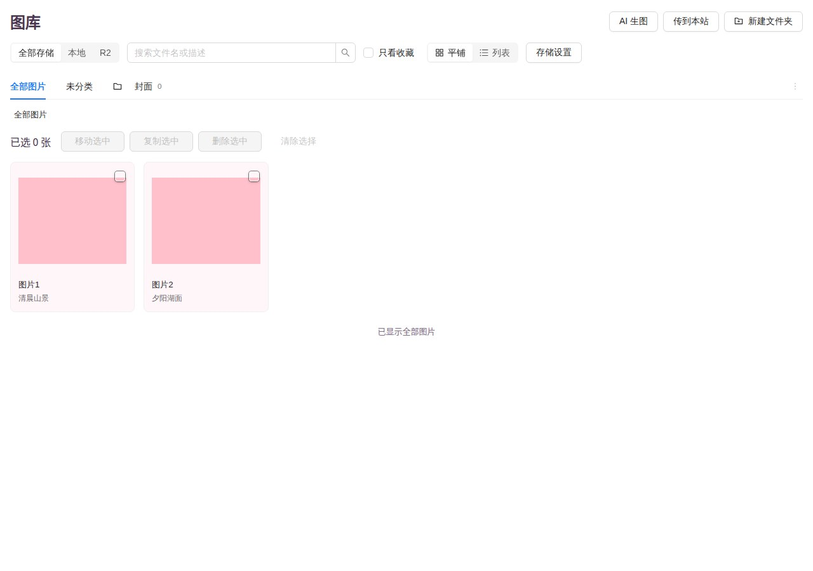
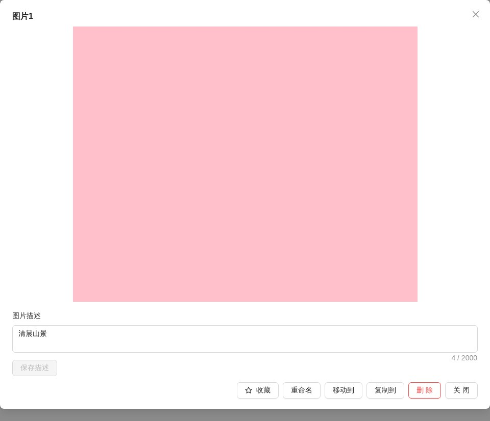
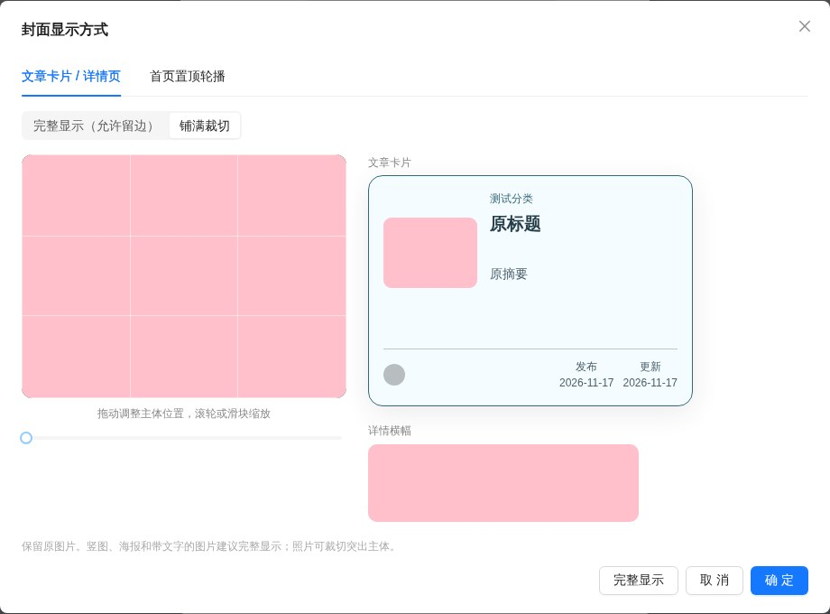
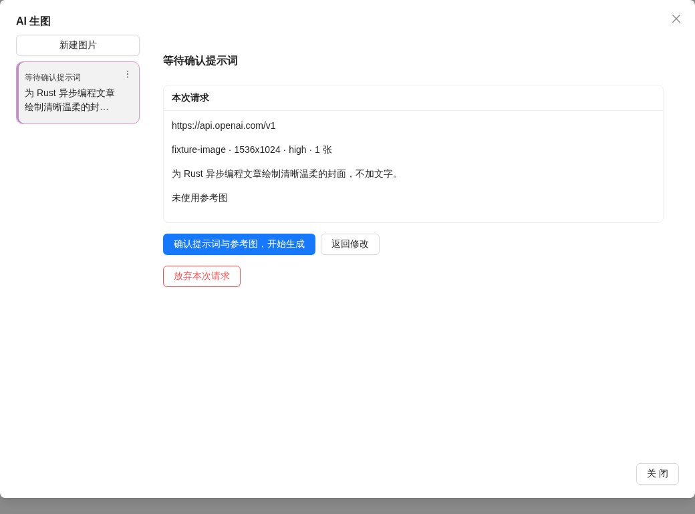
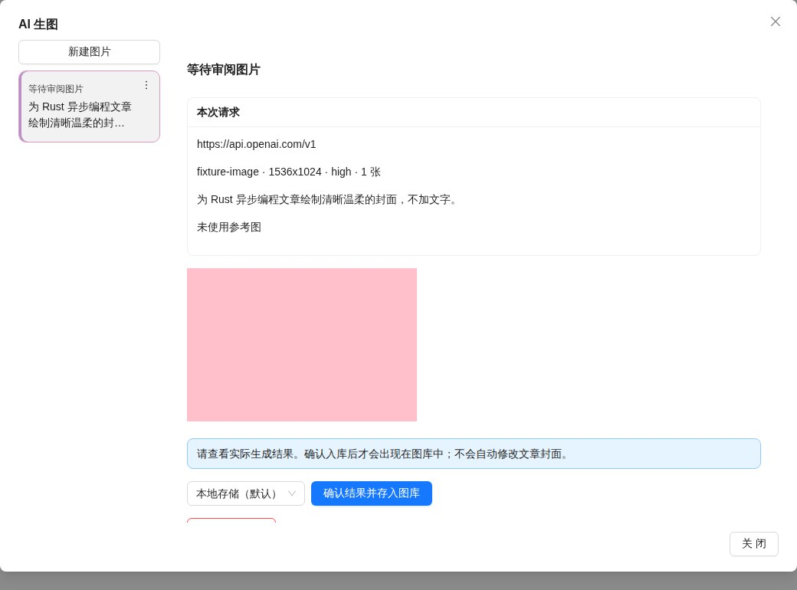

# 图库、封面和两阶段 AI 生图

**需要：**管理员打开后台「图库」。默认使用本地存储；不开 R2 也能整理图片。
图库权限和图片生成服务由服务器配置，缺失时按提示处理，不填写假密钥消除提示。

## 1. 浏览和整理

按文件夹浏览，点击缩略图查看详情；批量操作主动勾选图片，打开详情不等于选中。
可以新建文件夹、重命名、添加描述和收藏，再重新打开核对结果。

描述写清图片内容和适合的用途，便于检索或 Agent 选封面。
删除前核对对象与引用影响，删除按钮不是关闭详情。复制形成独立副本，移动改变位置；
跨存储转移要看到完成状态，排队不代表源文件可以手工清理。

## 2. 在文章里选择封面

1. 打开文章编辑器，点击提交进入发布设置。
2. 点击「图库选择」，找到真实图片，点选后等待裁剪/显示方式窗口加载。
3. 比较「完整显示」与「铺满裁切」，检查卡片标题覆盖及详情横幅。
4. 确认选择，核对草稿保存，再决定是否发布文章。

列表、缩略图、选中预览和裁剪是不同资源请求；某一步失败按
[图片排障](https://github.com/BigLeopardCat/Saudade-Blog/blob/cn_sora_blog/docs/troubleshooting.md#图片加载的具体检查)查实际状态，
不反复上传同一张图片，也不绕过访问授权。

## 3. 审阅一次生成请求

点击「AI 生图」，填写提示词、模型、尺寸/质量，并按需选参考图。
例如“给异步编程文章做一张无文字封面”，随后点击「预览请求」。

核对完整提示词、实际模型、尺寸、质量和冻结参考图，再点击
「确认提示词与参考图，开始生成」。此时才可能调用计费服务。
模型名与尺寸以你配置且获准的服务为准，图中的 fixture-image 只是隔离测试模型名。

## 4. 查看结果，再决定保留

图中粉色图片是合成占位图，不代表模型输出质量。
查看结果和参考图，决定「确认结果并存入图库」或拒绝。等待保存完成、获得真实图片编号后，
再从图库选择封面；生图、保留、设封面和发布文章是独立步骤。

生成中和保存中不能当作完成。超时或结果未知先查原任务与供应商记录，不盲目再生成一次。
Rust 自身可提供生图界面，不要求必须通过聊天 Agent 操作。

## 5. 配置 R2

从图库的配置入口或后台站点配置进入「图库存储」，按
[站点配置](https://github.com/BigLeopardCat/Saudade-Blog/wiki/Site-Configuration)填写自己的桶、前缀和公开来源。
图库服务凭据与发布产物凭据分开，云服务商账单也不是页面显示配额。

**完成标志：**图库能重读目标记录，原图可访问，封面预览可用；生图入库必须有明确成功与真实图片编号。
