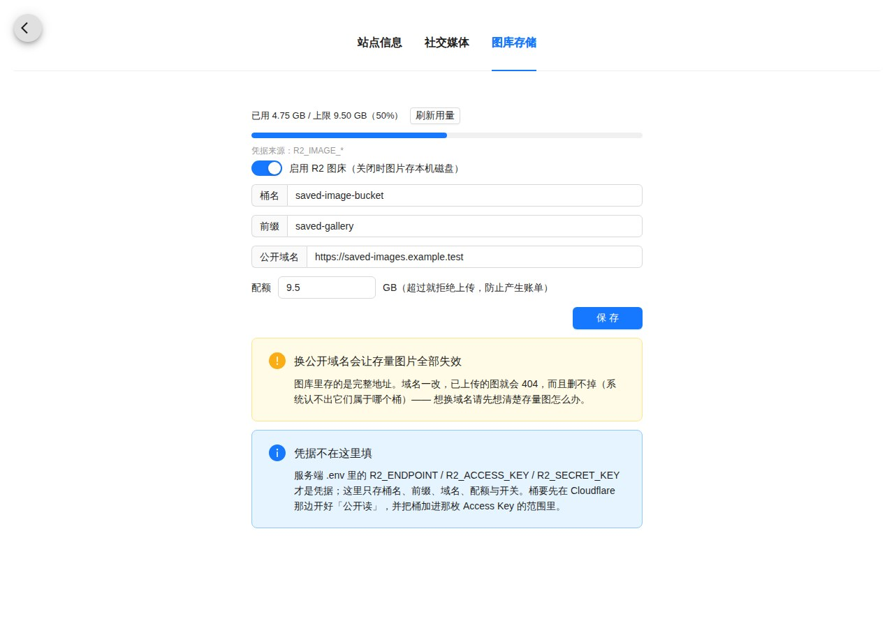

# 配置在哪里改、每项填什么

配置分成**安装器生成的私有文件、服务端环境文件、构建时前端配置、后台可编辑设置**。
不要把全部字段都填进后台，也不要把服务器密钥写成 VITE_ 变量交给浏览器。

## 从安装器开始

容器新装按[安装与升级](https://github.com/BigLeopardCat/Saudade-Blog/wiki/Installing-and-Upgrading)生成配置。
默认私有目录 `~/.local/share/saudade/compose`，自定义安装以实际 state-dir 为准。

| 文件 | 谁使用 | 新手需要知道 |
| --- | --- | --- |
| compose.env | Compose 编排 | 服务版本、目录与功能组合；不当作 shell 脚本执行 |
| backend.env | Rust 博客 | 业务库、站点来源、签名与可选服务配置 |
| agent.env | Agent 与可选 Worker | 模型、独立状态库、Agent 预算；不复制整份 backend.env |
| administrator.json | 首次账号引导 | 仅空用户表时创建站长，后续改此文件不重置旧账号密码 |
| installation.json | 安装状态 | 与实际功能、Agent 来源版本保持一致，不靠手改它强制接管其他安装 |

用私有编辑器修改文件，保留原所有者和权限。不要在命令行打印完整配置，也不要 source 执行。

## 核心字段的填写方式

| 字段 | 填什么 | 常见误填 |
| --- | --- | --- |
| DATABASE_URL | 本安装的 PostgreSQL 业务库连接 | 把测试库、Agent 库或其他站点的库填进来 |
| JWT_SECRET | 安装器生成或独立随机的登录签名密钥 | 使用模板值、把它交给 Agent 或暴露前端 |
| SITE_URL | 用户实际访问的完整站点来源，例如 https://blog.example.com | 写成 Docker 服务名或漏掉必要端口 |
| VITE_SITE_URL | 常规前端构建使用的站点来源 | 只改后端却期待旧静态文件改变；容器可移植模式另按部署指南处理 |
| UPLOAD_DIR | 可持久写入并随备份保留的上传目录 | 放进每次替换的发布目录 |
| AGENT_URL | Rust 能访问的内部 Agent 聊天地址 | 让浏览器直连内部端口，或用不存在的 Docker/loopback 地址 |
| AGENT_ASSERTION_SECRET | Rust 与 Agent 相同的服务身份断言密钥 | 两端各生成一个不同值 |
| BLOG_DELEGATION_SECRET | 仅 Rust 持有的工具委托签名密钥 | 复制给 Agent；它应转发宿主签发的有限委托 |

模型、邮箱、审核和图片生成字段从[环境模板](https://github.com/BigLeopardCat/Saudade-Blog/blob/cn_sora_blog/.env.example)
逐项选择。未使用的可选能力保持关闭，不要为了清空提示填入假密钥。

## 后台站点设置

打开后台站点配置页面（路由 `/dashboard/usercontrol`），检查三个页签：

1. **站点信息**：博客标题、作者、个性签名、备案与版权署名。字段下的优先级提示也要阅读，作者署名可能优先取个人中心昵称。
2. **社交媒体**：填写自己的 GitHub、Bilibili、Email、QQ；保存后在前台检查真实链接。
3. **图库存储**：可选开启 R2，配置桶名、前缀、公开域名和配额，核对下面显示的实际生效信息。

## R2 图库示例

先在 Cloudflare 创建独立图库桶，再生成仅允许该桶对象读写的凭据，保存 Access Key ID、
Secret Access Key 和该桶对应的 S3 endpoint。不要把公开图片域名当作 API endpoint。
官方入口见[R2 凭据](https://developers.cloudflare.com/r2/api/tokens/)。

为桶连接自己的公开域名，开发用 r2.dev 不当作生产访问方案；设置完成后再填写博客的公开域名。
步骤见[公开桶与域名](https://developers.cloudflare.com/r2/buckets/public-buckets/)。

| 后台字段 | 示例值的含义 |
| --- | --- |
| 桶名 | 你自己建立的图库桶，例如 gallery-images；不要用发布产物桶 |
| 前缀 | 对象命名空间，例如 gallery；不是完整 URL |
| 公开域名 | 真实可读取图片的来源，例如 https://img.example.com |
| 配额 | 本站用于展示和限制的容量设置，不等于云服务商账单或余额 |

图：保存的示例配置与实际使用量。这里不填写 Access Key 或 Secret Key。

图中的 R2_* 是兼容名称；本教程使用独立的图库凭据 R2_IMAGE_*，不复用发布凭据。
服务端另配 `R2_IMAGE_ENDPOINT`、`R2_IMAGE_ACCESS_KEY`、`R2_IMAGE_SECRET_KEY`；后台不填写这些密钥。
截图只有示例桶名和示例域名，必须替换成自己的。显示来源、实际桶和已用容量与表单草稿不同，
保存后重新读取核对。图库能列出图片后还要验证原图和封面裁剪，不能只看列表成功。
发布工具另用一套 R2 字段，不能与图库凭据混用。
浏览器跨域报错时，按真实请求检查允许的本站 origin、方法和请求头，见
[R2 CORS](https://developers.cloudflare.com/r2/buckets/cors/)；origin 不包含文章路径。

## 改完怎样生效

后台设置保存后按页面提示重读；服务端环境变更需要按安装方式重启对应服务；
前端构建字段改变需要重新构建和发布静态文件。生产使用部署指南里的命令，不能直接启动开发工作树。
先核对就绪、实际构建和一次只读请求，再验收需要的功能。
完整来源与升级约束见[配置导航](https://github.com/BigLeopardCat/Saudade-Blog/blob/cn_sora_blog/docs/configuration.md)。
