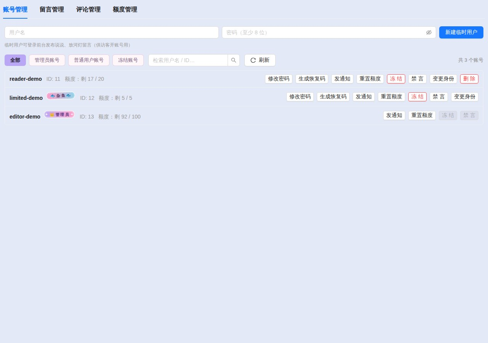

# 用户、权限和聊天额度

**入口：**后台「用户管理」，包含「账号管理」「留言管理」「评论管理」「额度管理」。需要管理员；能看到后台不代表能操作所有账号。
首次部署的站长账号由安装引导创建，不能用普通账号管理页面把自己升级为超级管理员。

## 先认识角色

| 角色 | 使用时的理解 |
| --- | --- |
| superadmin（超级管理员） | 站长级管理，首次空库引导创建；不等于 PostgreSQL 超级用户 |
| admin（管理员） | 后台管理，但不能按普通管理入口管理同级管理员或超级管理员 |
| user（普通用户） | 本人功能与获授权的聊天工具，不具有后台管理权 |
| zako（杂鱼） | 受限身份；不能按普通用户或管理员推定工具权限 |

具体限制由服务端核验；按钮禁用时看原因，不通过修改网页或对话自述提升权限。

## 给访客创建账号

1. 打开「账号管理」，在「用户名」和「密码（至少 8 位）」输入框填写账号。
2. 使用独立密码，不使用站长密码；点击「新建临时用户」。
3. 在列表核对用户名和实际角色，再通过私下渠道交付初始凭据，让对方登录验证。
4. 需要后续管理时，以账号名/编号定位；昵称可能重复，不直接把昵称当身份。

图：账号管理页，显示示例账号、角色、额度和操作入口。示例数据仅用于说明。

首次站长密码与这里新建账号的密码规则是不同入口的约束，以各自表单和安装指南为准。
真实密码、一次性恢复码和登录令牌不能放在教程截图里。

## 常用管理操作

| 操作 | 怎么用 | 要核对的后果 |
| --- | --- | --- |
| 冻结 / 解冻 | 选择账号，核对确认窗口，再提交 | 冻结会使已有登录失效；解冻后重新登录，旧会话不会恢复 |
| 禁言 / 解除禁言 | 选择期限并核对截止时间 | 限制评论与留言，不能据此推断已冻结登录；永久禁言要特别核对 |
| 变更身份 | 核对原角色和目标角色 | 普通管理员的可操作范围更小；不能通过此入口指派 superadmin |
| 重置额度 | 核对账号、恢复额度及通知 | 恢复可用额度，不等同于充值、改角色或恢复已冻结账号 |
| 发通知 | 核对接收人、标题、完整正文 | 仅发给选定账号；与全站公告不同 |
| 修改密码 / 恢复码 | 只通过实际页面允许的入口操作 | 私密凭据另行交付，不复制进聊天或公开工单 |
| 删除 | 确认账号和关联数据提示后再决定 | 不是临时下线；想暂时阻止登录时优先考虑冻结 |

不能冻结、禁言或改自己的身份；不能操作超级管理员。普通管理员不能管理同级管理员。
遇到拒绝先核对操作者与目标身份，不反复点击或绕过确认。

## 留言与评论管理

在「留言管理」「评论管理」切到准确对象和状态，打开完整内容，核对发布者与关联文章后再审核或删除。
审核通过、拒绝、删除是不同动作；读取失败不能按“没有内容”处理。
匿名或昵称显示不授予账号权限，删除一条评论也不等于删除其文章或账号。

## 处理额度申请

打开「额度管理」，读申请人、原因、当前额度与处理状态，再批准或拒绝。
完成后核对状态和通知。用户自己的申请入口在个人中心「对话额度」，不是后台权限申请。

**完成标志：**刷新后的账号/申请状态与操作结果一致，必要时让测试账号重新登录验证。
[账号契约](https://github.com/BigLeopardCat/Saudade-Blog/blob/cn_sora_blog/docs/account-actions.md)说明版本和权限边界。
