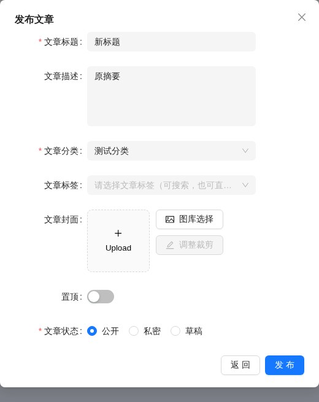
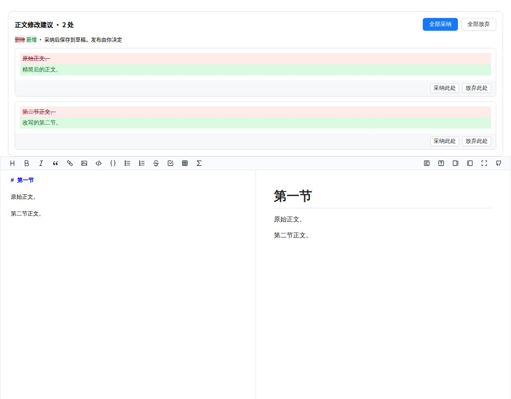

# 写第一篇文章，再学会管理已发布内容

**需要：**管理员登录后台。先完成[分类标签](https://github.com/BigLeopardCat/Saudade-Blog/wiki/Categories-and-Tags)准备，
用一篇自己的测试草稿练习。

## 1. 建草稿与预览

打开「笔记 → 编辑文章」，填写 Markdown。先用短文：

```markdown
# 第一篇文章

这是一个测试段落。

## 记录

- 写作目标
- 使用条件
```

编辑器可预览正文、代码、公式和 Mermaid。代码使用围栏，图片先上传或从图库选择；
不要把服务器磁盘路径当成浏览器可访问的图片 URL。写完核对预览，再检查草稿保存状态。

## 2. 填发布设置

点击「提交」，在「发布文章」窗口逐项检查：

| 项目 | 怎么填 |
| --- | --- |
| 标题 | 清楚描述主题；正文一级标题不能代替发布标题 |
| 描述/摘要 | 用于列表阅读的简短概述，可空时按实际表单要求；不把它当全文正文 |
| 分类与标签 | 选已建立的字典项，核对主/子标签层级 |
| 封面 | 从图库选择，分别预览卡片与详情显示方式 |
| 可见性与其他选项 | 核对公开/私有等状态和当前界面可用设置，再发布 |



图：发布窗口，显示标题、描述、可见性及发布按钮。示例数据仅用于说明。

## 3. 选择封面

在发布窗口选择「图库选择」，点中真实图片后等待「封面显示方式」加载。
竖图、海报或文字图片先比较完整显示；铺满裁切时拖动位置与调整缩放，核对重要内容没有丢失。
卡片和详情横幅分别看，确认后再检查草稿保存。


图：完整显示与铺满裁切、实际卡片预览。示例数据仅用于说明。

列表缩略图加载成功不代表选中后的裁剪资源也成功。错误时按
[图库教程](https://github.com/BigLeopardCat/Saudade-Blog/wiki/Gallery-and-Image-Generation)排查，不连续重复上传。

## 4. 发布并去前台验证

核对完整内容后点击发布，等待明确结果，打开文章真实链接检查标题、正文、封面、分类和标签。
私有状态不应以公开链接可读为成功标准；按当前账号与权限验证。
本地修改、草稿保存、发布成功是不同状态，不能用一条成功提示替代全部验证。

## 5. 修改、置顶和删除

从「笔记 → 全部文章」按标题、状态等条件找到准确文章，再进入编辑或对应操作。
已发布文章继续编辑时保留原文与草稿边界；版本冲突重新读取并合并，不用旧自动保存覆盖新内容。
置顶改变首页展示，不等于发布；删除前确认目标与永久影响，多选时核对实际选择集合。

## 6. 用 Agent 协作

保持编辑器打开，提出具体范围，例如“只润色第二段，保留事实和代码”。
阅读红删绿增的差异，逐段或整批采纳，之后检查保存；摘要通过独立确认卡应用。
长差异向下滚动读完，自己的继续输入或切换文章会使旧提议需要重新读取。



图：原文、修改建议与采纳入口。示例数据仅用于说明。

AI 建议不是已保存的文章，生成或保留图片也不会自动发布。
当前约束见[协作编辑](https://github.com/BigLeopardCat/Saudade-Blog/blob/cn_sora_blog/docs/article-collaboration.md)。
